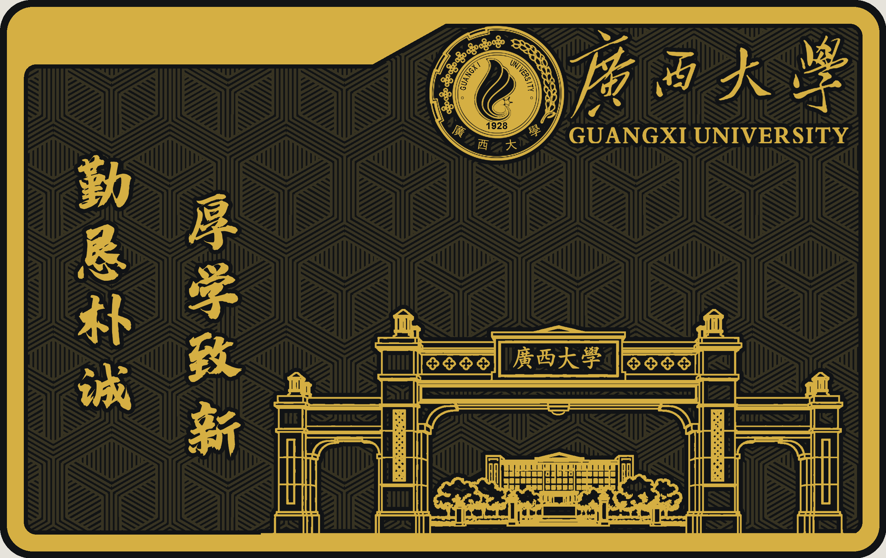
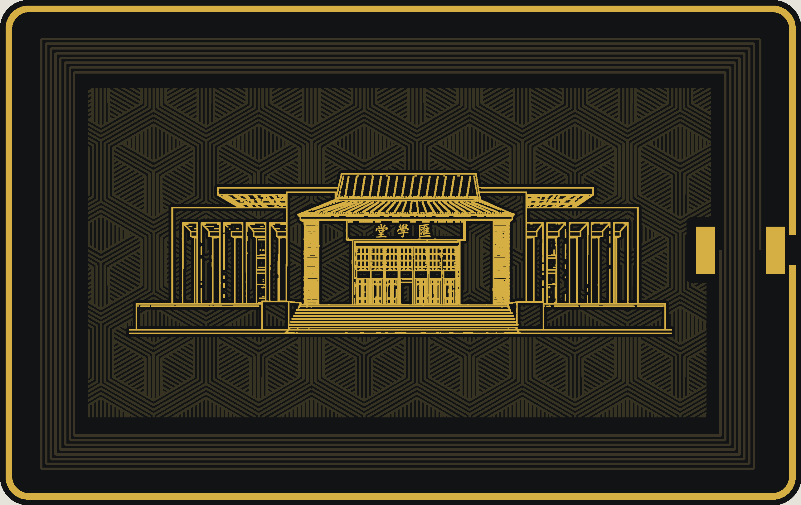

# 广西大学黑金 PCB 卡 · V9 无灯版

`GXU-BlackGold-V9-NoLED` 是以广西大学为主题的黑金色 PCB 卡片设计。正反面融入校徽、校训、南大门和汇学堂。V9 放大了校徽、校名与建筑图案，并调整了牌匾字形和局部线条间距，以改善小尺寸下的辨识度。

## 特别鸣谢

**特别感谢嘉立创提供 PCB 免费打板服务**，让个人制作者可以用较低成本把设计做成实物，验证细线、文字和阻焊开窗的效果。活动资格及可选工艺以 [嘉立创免费打样规则](https://www.jlc.com/portal/server_guide_65083.html) 为准。

## 正反面预览

可进一步查看[校徽局部](previews/校徽细节预览.png)和[三处文字细节](previews/三处文字细节.png)。预览为设计渲染，实物颜色和线条效果取决于制板工艺。

## 工程文件

| 文件 | 用途 |
| --- | --- |
| [GXU-BlackGold-V9-NoLED.epro2](GXU-BlackGold-V9-NoLED.epro2) | 嘉立创EDA专业版工程归档，可导入编辑 |
| [GXU-BlackGold-V9-NoLED.epcb2](GXU-BlackGold-V9-NoLED.epcb2) | 单独的 PCB 版图源文件 |
| [GXU-BlackGold-V9-NoLED-Gerber.zip](GXU-BlackGold-V9-NoLED-Gerber.zip) | 制板用 Gerber 压缩包 |
| [DRC.json](DRC.json) | 随工程保存的设计规则检查记录，空数组表示该次检查未报告问题 |

## 打开与打样

1. 在支持 `.epro2` 的嘉立创EDA专业版客户端中导入工程归档，打开 PCB 查看或编辑。[官方导入指南](https://prodocs.lceda.cn/cn/import-export/import-lceda-pro/)
2. 打样时上传 Gerber 压缩包，预览板框、铜层和阻焊开窗。建议选择黑色阻焊和沉金，以呈现黑金配色。
3. 校徽内圈小字、牌匾和屋顶细线对线宽、铜间距和阻焊开窗较敏感。下单前请由板厂审核这些区域，先做少量样板验证。

背面保留天线和两个芯片焊盘，芯片尚未选型及装配。若需实现 NFC 功能，装配后还需验证天线谐振和读取距离。

校训使用字魂白鸽天行体。涉及商业使用时，请向字体权利方确认授权。
