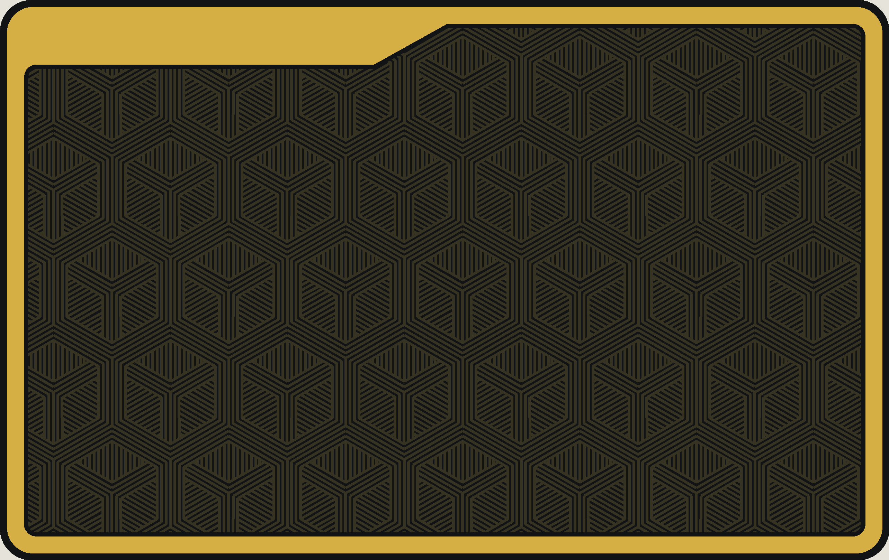
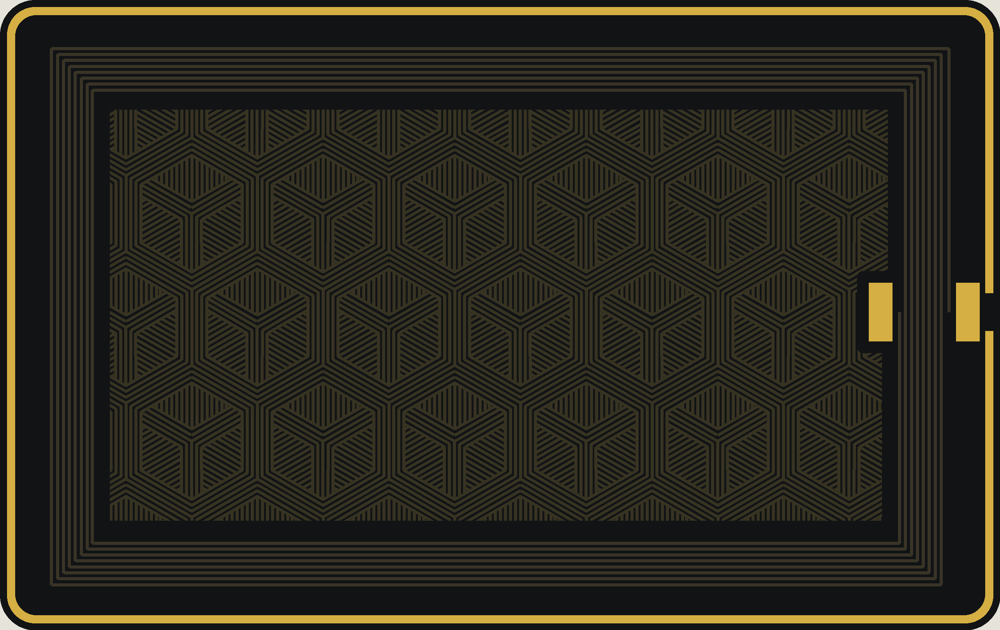

# V9 通用底纹线圈版

本版本基于广西大学黑金 PCB 卡 V9 无灯版，移除了校徽、校名、校训、南大门和汇学堂图案，并在相应位置铺回底纹。保留黑金边框、几何底纹、NFC 天线线圈和芯片焊盘，供进一步设计使用。原版线圈、焊盘及板框数据与通用版一致。

## 预览

预览为设计渲染，实际颜色及线条效果取决于制板工艺。

## 工程文件

| 文件 | 用途 |
| --- | --- |
| [V9-Generic-NoLED.epro2](V9-Generic-NoLED.epro2) | 嘉立创EDA专业版工程归档，可导入编辑 |
| [V9-Generic-NoLED.epcb2](V9-Generic-NoLED.epcb2) | 单独的 PCB 版图源文件 |

## 打开与制板

在嘉立创EDA专业版中导入 `.epro2` 工程。此版本尚未重新运行设计规则检查或导出 Gerber，制板前请检查铜层、阻焊开窗和板框，运行 DRC 后重新导出 Gerber，并在下单页面核对预览。建议先制作少量样板。

背面保留天线和两个芯片焊盘；芯片尚未选型和装配。若需实现 NFC 功能，装配后还需验证天线谐振和读取距离。
